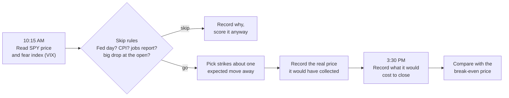

# SPY Credit-Spread Bot

**An AI-built research system that tests whether a simple daily options strategy can make money *after* real-world costs, before any money is risked.**

I come from accounting, not software. I designed the strategy, the rules and the safety limits, and directed an AI coding agent ([Claude Code](https://claude.com/claude-code)) to build and test it. Every number in this project is checked against real data, and every assumption is written down.

> **Current stage: research only.** The system downloads market data, runs a backtest and records real option prices each day. It cannot place trades: order tools are blocked in four separate ways (see [Safety](#safety-first)). Nothing here is financial advice.

---

## The idea in one minute

Every trading day, SPY (a fund that tracks the 500 largest US companies) has options that expire **the same day**. The strategy sells a *credit spread*: a small, capped bet that SPY will **not** move very far by the afternoon.

- If SPY stays inside a safe zone, the bot keeps a small payment (the "credit"), often around $10–$40 per trade.
- If SPY moves too far, the loss is capped, but one loss can wipe out many wins.

So the real question is a math question: **is the payment big enough to cover the occasional loss, plus fees and slippage?** This project answers it with evidence instead of hope.

## What it has found so far

**The backtest (2022–2024, about 660 trading days of real SPY prices)** works out the *break-even credit*: the smallest payment each version of the strategy needs to collect, after cautious fees and slippage, just to break even.

An example from the [first report](reports/backtest-2026-11-17.md), for spreads $5 wide with the strike about one expected move away:

| Version | Days traded in 2024 | Days it lost money | Needs at least (per share) |
|---|---|---|---|
| Sell a put spread every day | 252 | 6.3% | **$0.24** |
| Plan v2 rules (follow the trend, skip risky days) | 187 | 3.2% | **$0.13** |

**Plain-English reading:** the rules roughly halve the losing days and the credit needed. Whether real option prices pay more than that is exactly what the daily logger now measures.

**The honest limit:** historical option prices cost money, so past days use real SPY prices but *estimated* outcomes. This method can show with confidence that a setup **does not** work. It can only hint that one does. Every report says so on its first line.

## Safety first

Robinhood's "approve each trade" setting is off on the account, so an order tool would trade for real. The project guards against that four ways:

1. **Written rules** that every AI session reads first ([CLAUDE.md](CLAUDE.md)).
2. **Permissions** that block every order tool before it can run ([.claude/settings.json](.claude/settings.json)).
3. **An automatic test** that fails if any code even *names* an order tool ([tests/test_no_orders.py](tests/test_no_orders.py)).
4. **A read-only runbook** for the scheduled data runs ([collector/logger-task.md](collector/logger-task.md)).

The guiding rule is **"when unsure, do nothing and ask."** A second automatic test ([tests/test_public_safety.py](tests/test_public_safety.py)) keeps account numbers and other private details out of this public repo.

## How it was built

| My role (owner) | The AI agent's role |
|---|---|
| Chose the strategy and wrote the rules ([plan v2](docs/plan-v2.md)) | Turned the rules into a design and a step-by-step build plan |
| Approved every design and every rule change | Wrote each piece test-first: a failing test, then the code, then a passing test |
| Decided the cost assumptions and the pass/fail bar | Checked the data against a second public source (Cboe) |
| Approved anything that touches the account or costs money | Reported findings with evidence, including its own mistakes |

**Built with:** Python 3.9 (standard library only), pytest (100+ automated tests), Claude Code, the Robinhood connector (read-only), and Cboe's public VIX history.

## Where to go next

| If you want… | Read |
|---|---|
| A 5-minute overview | This page, then [docs/journey.md](docs/journey.md) (what happened and what I learned) |
| How it works, in plain words | [docs/how-it-works.md](docs/how-it-works.md) and the [glossary](docs/glossary.md) |
| The strategy rules | [docs/plan-v2.md](docs/plan-v2.md) |
| The full design and build plan | [docs/superpowers/](docs/superpowers/) |
| To rebuild it on a new computer | [RECOVERY.md](RECOVERY.md) |
| Everything else | [docs/README.md](docs/README.md) |

## Roadmap

1. **Logging real option prices** ← *now*
2. Backtest proves an edge after cautious costs
3. Paper trading for 30–60 days
4. Live with one contract, each trade approved by hand
5. Fully automatic, only after weeks of matching results

A stage passes only if results are positive after the cautious cost case.

---

*Not financial advice. This is a personal research project. All rights reserved.*
